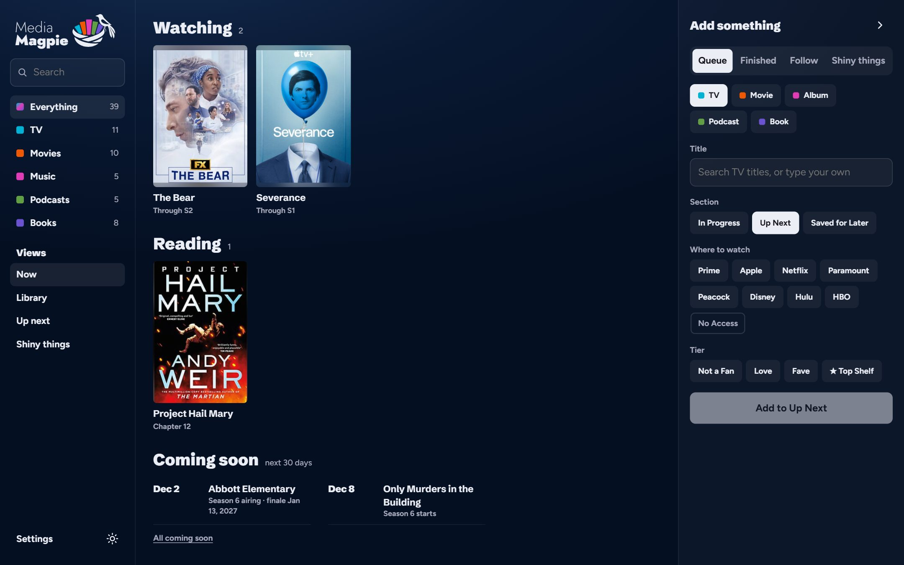
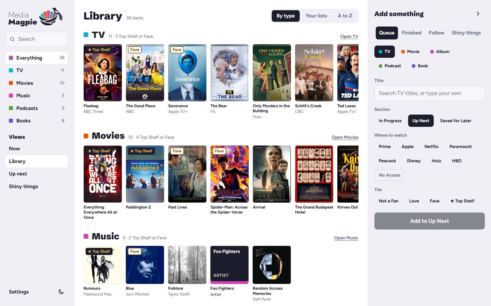
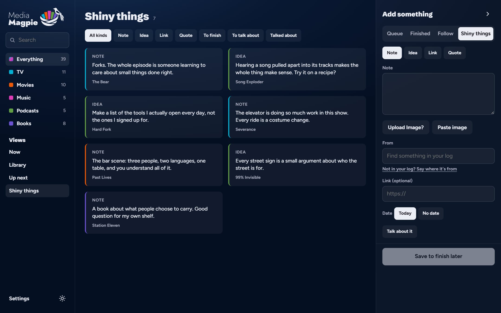
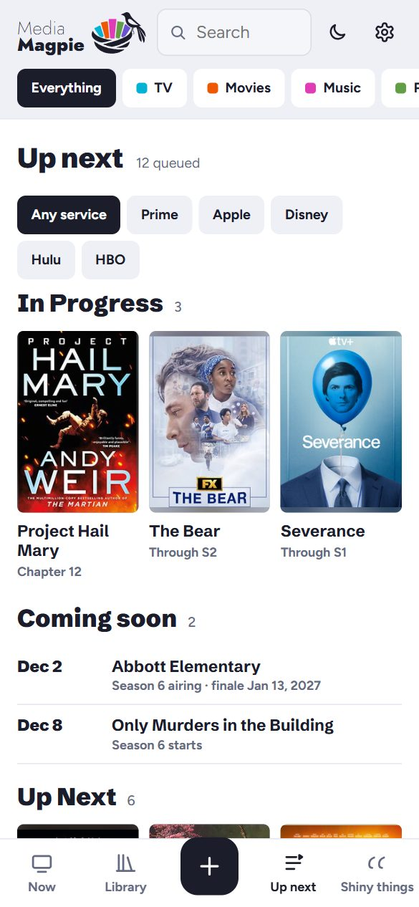
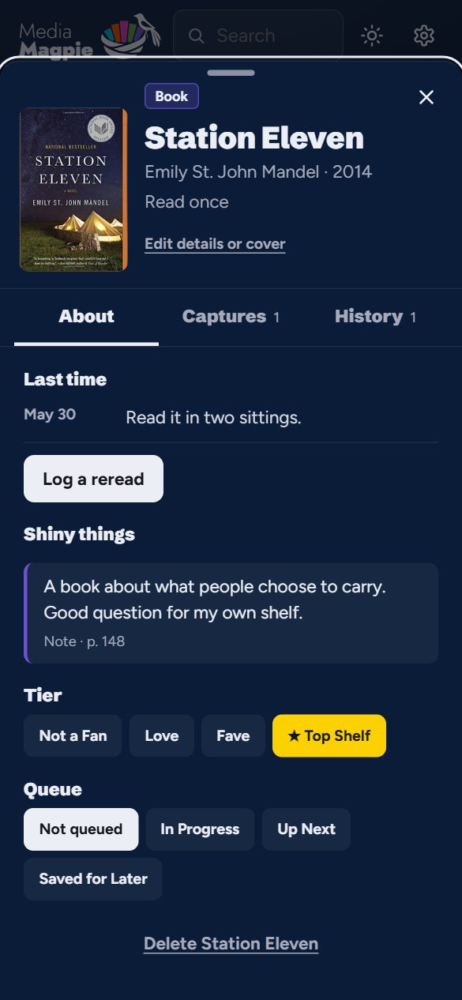
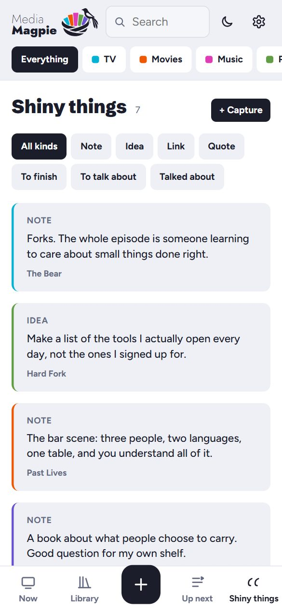

# Media Magpie

*shiny things for eyes and ears*

Media Magpie is a diary for everything you watch, listen to and read: TV, movies, music, podcasts and books, all in one place. Log what you finished, rate it on your own tiers, keep a queue of what's next, and see when your shows come back.

It also keeps **Shiny things**: the lines, ideas and small moments worth remembering, saved with where they came from, down to the episode and the minute. That's the magpie part.

It runs on your own computer or your own hosting, and your data stays yours: everything exports to one file, any time.

I wanted to be able to track all my media consumption in one place, and also save notes on the shiny things that grab my attention.



## What it does

- **Now**, the home screen: what you're watching and reading, what lands in the next few weeks, and what's ready to start.
- **Add from anywhere.** On a desktop the Add something panel is always open on the right; on a phone the + is one tap away. Queue, log a finish, follow or capture without opening anything.
- **History.** Log what you finished, with a note if you like. A rewatch or reread is a new entry; nothing is overwritten.
- **Library.** Everything you've added, one shelf per type, sorted by your own tiers (Love, Fave, Top Shelf), your own lists, or A to Z (books by author too). Podcasts and music you follow live here.
- **Up next** in three sections (In Progress, Up Next, Saved for Later). Shows and movies can say which streaming service they're on, and Up next filters by service.
- **Coming soon.** New seasons and episodes of your shows with real air dates from TVmaze, and movies with a release date you've set, soonest first. Nothing undated is shown.
- **Shiny things.** Quotes, ideas, notes and links, tied to something you logged or standing alone with a source. Each can carry the episode and the time it came from (type `1309`, get `13:09`) and an image.
- **Finish later.** No time to write it down? Save just where it came from, or just a screenshot. It waits under **To finish** until you write it up.
- **Talk about it.** Flag a capture you want to think through with an AI assistant later. It waits under **To talk about**, then keeps the date and one line on where you landed. Words an assistant wrote for you are tagged **Written by Claude** until you rewrite them.
- **Search** from any screen: titles, people, list names, notes and captures.
- **Covers find themselves** (Open Library, Apple, TVmaze, Wikipedia), looked up on the server. Typing it in yourself always works too.
- **Find in Libby.** Add your library in Settings and every book links to a Libby search.
- Works on a phone and a desktop, in light and dark. One password.

<table>
  <tr>
    <td width="50%"></td>
    <td width="50%"></td>
  </tr>
  <tr>
    <td><b>Library.</b> One shelf per type, your favorites first.</td>
    <td><b>Shiny things.</b> The lines and ideas worth keeping, with where they came from.</td>
  </tr>
</table>

<table>
  <tr>
    <td width="33%"></td>
    <td width="33%"></td>
    <td width="33%"></td>
  </tr>
  <tr>
    <td><b>Up next</b>, by streaming service, with what's coming soon.</td>
    <td><b>Every title has a page</b>: when you last finished it, what you saved from it, and your tier.</td>
    <td><b>On your phone</b>, the + is always in the middle.</td>
  </tr>
</table>

*The screenshots show a throwaway library of well-known titles, not anyone's real one.*

Built with Next.js, React and Postgres. Runs locally with no accounts, using an embedded Postgres ([PGlite](https://pglite.dev)) that keeps its files on your disk. Deploys anywhere Next.js runs, with any Postgres.

## Run it locally

You need [Node.js](https://nodejs.org) 20 or newer.

```bash
npm install
```

```bash
npm run dev
```

Open http://localhost:3456. The first run creates `.env.local` with a random password; open that file to see it, or change it (the sign-in page says so too).

The first run also creates the database in `./data/db`, and it starts empty. Now greets you with three first steps (add a show, queue something, capture a line) over a faint row of example covers, which are only pictures and go away with your first add. To look around first, choose "Or load a small demo library to look around" there: it loads a small fictional library as ordinary entries you can delete. To start from your own data instead, see [Bringing your own lists](#bringing-your-own-lists).

For an always-on local copy, build once and use the production server:

```bash
npm run build
```

```bash
npm start
```

## Your data

- **Where it lives.** Locally: `./data/db` (embedded Postgres files). Hosted: whatever `DATABASE_URL` points at.
- **Nothing is hard-deleted from the app.** Deleting moves things to Settings, Recently deleted, where they can be restored.
- **Export** (Settings, or `GET /api/export`) writes one JSON file with everything, deleted entries included. Capture images are stored in the database and travel inside the export (as base64), so an export is whole on its own; each image adds a few hundred KB.
- **Import** (Settings, or `POST /api/import`) merges an export by id: entries in the file are added or updated, nothing else is touched. It is all-or-nothing; a bad file changes nothing.
- **Automatic local backups.** On the embedded database, every change also writes a full export to `./data/backups/media-log-YYYY-MM-DD.json`, one file per day: the newest 14 are kept, then one a week for the 8 weeks before that. Capture images are saved once each in `./data/backups/images/` rather than inside every daily file, so the daily files stay small; keep that folder with them. Restore one with Import: the app reads any image it doesn't already have from that folder, and refuses the whole file (changing nothing) if one is missing.
- `./data` is gitignored, so your library never ends up in a commit.

### Bringing your own lists

On first boot the embedded database seeds itself from the first file it finds:

1. the file named by `SEED_FILE`
2. `data/seed.personal.json`

With neither, it starts empty (the fictional demo no longer loads by itself). A seed file is an ordinary export file (see `seed/demo.json` for the shape). It runs once per database, and never touches one that already has anything in it. To re-seed, stop the app, delete `./data/db`, and start again. `SEED_FILE=none` starts empty even when `data/seed.personal.json` exists.

The demo is `seed/demo.json`. Load it from the empty library's welcome on Now (or `POST /api/demo`, which is refused once the library has anything in it), or start with it already in place:

```bash
SEED_FILE=seed/demo.json npm run dev
```

(or put `SEED_FILE=seed/demo.json` in `.env.local` before the first start).

The example covers on the empty library's welcome come from `lib/examples.ts`, a plain list of titles you can edit. The repo holds no cover images or image links: each cover is looked up when the page shows, and a title that finds none gets a plain tile.

## Deploy it

Any host that runs Next.js should work. The intended shape is Vercel plus a Neon Postgres database:

1. Create a Postgres database (Neon's free tier is plenty: 0.5 GB per project at the time of writing, and capture images, a few hundred KB each, count toward it) and copy its connection string.
2. Optional, recommended before moving real data: rehearse. Put the connection string in `.env.local` as `HOSTED_DATABASE_URL` (the app never reads that name), export your local library, then run `npm run build` and `node scripts/pgcheck.mjs <export.json>`. It runs a throwaway copy of the app in a scratch schema of that database, imports the file, compares every row on the way back out, tries a capture with an image, and drops the scratch schema.
3. Import this repo into Vercel.
4. In the Vercel project's environment variables, set `APP_PASSWORD` (long: on a host with many instances the slow-down on wrong guesses resets often, so the password's length is what protects you), `DATABASE_URL`, and `API_TOKEN` (backups need it). Optionally `MOVIE_API_KEY`.
5. Deploy. The tables are created on first request, and the hosted database starts empty. Load your library with an export from your local copy, either way:
   - **Small file:** Settings, Import on the hosted site. Vercel refuses a request over about 4.5 MB, and the hosted app keeps the default body limit.
   - **Any size:** run the app on your computer pointed at the hosted database and import there, so the file never goes through the host. For example `DATABASE_URL=<connection string> npx next dev -p 3457`, then Settings, Import at http://localhost:3457. Stop your usual local server first, and this one afterwards.
6. Set up backups. The automatic backup files only run on the embedded database, so a hosted copy has only its database provider's restore window (hours, on Neon's free tier). On a machine you trust, schedule a daily `npm run backup:pull` with `MEDIA_LOG_URL` (the hosted address) and `MEDIA_LOG_TOKEN` (the hosted `API_TOKEN`), in the environment or `.env.local`. It saves `media-log-hosted-YYYY-MM-DD.json` in `MEDIA_LOG_BACKUP_DIR` (else `BACKUP_DIR`, else `./data/backups`; set the first to keep these apart from a local server's own backups), kept like the local backups (the newest 14, then one a week for 8 weeks), with each capture image fetched once into `images/` beside them, so no single request passes the host's size cap. It refuses anything that isn't a real export, warns when entries go missing, and exits non-zero on failure so the scheduler shows it. To restore one, import it on a copy of the app whose `BACKUP_DIR` is that folder (pointed at the hosted database, as in step 5).

Without `APP_PASSWORD` the deployed app stays locked (it fails closed), and the API answers 503.

## Configuration

| Variable | Needed | What it does |
| --- | --- | --- |
| `APP_PASSWORD` | yes | The sign-in password. Changing it signs every device out. |
| `DATABASE_URL` | hosted | Postgres connection string. Unset = embedded database in `./data/db`. (`POSTGRES_URL` also works.) |
| `API_TOKEN` | no | Lets scripts call `/api/*` with `Authorization: Bearer <token>`. 16+ characters. |
| `MOVIE_API_KEY` | no | A TMDB key or read token for movie lookup. Unset = Wikipedia. |
| `AIR_DATES` | no | `off` stops the server asking TVmaze for air dates (Coming soon then stays empty). |
| `COVER_FILL` | no | `off` stops the server looking up a cover for something added without one. On, it saves a cover only when the title matches and the creator or year agrees too. When a lookup site doesn't answer (they refuse bursts of requests), the lookup is tried again later, up to four times over a few hours, after a page load or the next add. |
| `LOOKUP_FIXTURE` | tests | A JSON file of canned title lookups and air dates used instead of the lookup sites. The tests set it; leave it unset. |
| `LOCAL_DB_DIR` | no | Where the embedded database lives. Default `./data/db`. |
| `BACKUP_DIR` | no | Where local backups go. Default `./data/backups`. `LOCAL_BACKUPS=off` turns them off. |
| `SEED_FILE` | no | Seed file for a fresh embedded database (`seed/demo.json` for the demo), or `none`. Unset, a fresh database starts empty. |
| `TEST_COPY` | no | `1` puts a "Test copy: not your real library" strip on every page. For a copy that isn't the real one, such as a laptop once the hosted copy is real. |
| `WATCH_WITH_LABEL` | no | Who you watch with, as a chip reads ("With Sam"). Adds Everything / Solo / that chip on Now and Up next, and a Who with choice on shows and movies. It's also the tag on those shows, so renaming it later means retagging them. Unset, none of this appears. |
| `DEV_ORIGINS` | no | Comma-separated host names or addresses allowed to load the dev server (`npm run dev`) from another device, such as a phone over Tailscale. |
| `MEDIA_LOG_URL` | backups | The hosted address, for `npm run backup:pull` and other scripts that talk to a running copy. |
| `MEDIA_LOG_TOKEN` | backups | That copy's `API_TOKEN`, for the same scripts. |
| `MEDIA_LOG_BACKUP_DIR` | no | Where `backup:pull` saves. Else `BACKUP_DIR`, else `./data/backups`. |
| `BACKUP_ALERT_CMD` | no | A command `backup:pull` runs when it fails, with a title and a message as its last two arguments (say, one that files a note in your task tracker). Split on spaces. On Windows it also shows a notification; `BACKUP_NOTIFY=off` stops that. |

**A lost or stolen device:** sign-ins last 180 days and can't be cancelled one device at a time. Change `APP_PASSWORD` (on a host, in its environment settings, then redeploy): every device is signed out, and you sign back in with the new password.

## The API

Everything the page does goes through a small JSON API, so scripts and voice assistants can use it too. Sign in with the browser session, or send `Authorization: Bearer $API_TOKEN`. Writes must be JSON (`Content-Type: application/json`). Dates are `YYYY-MM-DD`; `null` means no date.

| Call | Does |
| --- | --- |
| `GET /api/state` | Everything: items, logs (finishes), captures. |
| `GET /api/items?type=&queue=&tier=` | Items, filtered. |
| `POST /api/items` | Add an item: `{ type, title, creator?, year?, coverUrl?, tier?, queue?, log?: { finishedOn?, detail?, note? } }`. Without `coverUrl`, the server looks one up afterwards and keeps it only on a sure match, so send `creator` and `year` when you have them. Adding several at once is fine: the lookups run one at a time, and one that gets no answer is tried again later. |
| `PATCH /api/items/:id` | Change fields, for example `{ tier: "top" }` or `{ queue: "saved" }`. `null` clears. |
| `POST /api/items/:id/move` | Move a queued item within its section: `{ top: true }`, `{ above: id }` or `{ below: id }`. Sets its `sortPos`; nothing else moves. Newest stays on top unless moved, and changing section clears it. |
| `DELETE /api/items/:id` | Soft delete (with its logs and captures). |
| `POST /api/items/:id/logs` | Log a finish: `{ finishedOn?, detail?, note?, keepInQueue? }`. Every call is a new entry. It takes the item out of its queue section unless `keepInQueue` is set; a show in `in_progress` (watching) always stays. |
| `POST /api/logs` | One-step log for scripts: `{ item: { type, title }, finishedOn?, note? }` finds the item by type and title, or creates it. |
| `PATCH` / `DELETE /api/logs/:id` | Edit or soft-delete one finish. |
| `GET /api/captures?talk=waiting` | Captures switched to Talk about it and not talked about yet. Each carries `item` (`{ id, type, title, creator }`) when it hangs off something in the log. |
| `GET /api/captures?mark=1` | Marks: captures saved with no words yet, shown as To finish. |
| `POST /api/captures` | `{ body?, kind?, itemId?, who?, source?, url?, note?, detail?, time?, talk?, image?, capturedOn? }`. Or `item: { type, title }` instead of `itemId` to attach by title. |
| `GET` / `PATCH` / `DELETE /api/captures/:id` | Read, edit or soft-delete one capture. `PATCH` takes the same fields, `item: { type, title }` included. |
| `GET /api/images/:id` | A capture image's bytes (JPEG, PNG or WebP). |
| `POST /api/restore` | `{ kind: "item" \| "log" \| "capture", id }` undoes a delete. |
| `GET /api/lookup?type=&q=` | Title search with covers. |
| `GET /api/export`, `POST /api/import` | Whole-library JSON out and in. `?images=none` on the export leaves the image bytes out (fetch each from `/api/images/:id`). |
| `GET /api/health` | Database kind and row counts. |
| `POST /api/covers` | `{ id }` finds a cover for one item and returns `{ pick, failed }` without saving. `pick.sure` means the creator or year agreed as well as the title; `failed` means a lookup site didn't answer. Settings, Find covers uses it. |
| `GET` / `PUT /api/settings` | Settings kept on the server: Libby libraries for book links and the order the types are listed in, `{ libby: [{ key: "nypl", name: "New York" }], typeOrder: ["tv", "movie", "music", "podcast", "book"] }`. `PUT` changes what it is sent: `libby` replaces the list (`[]` turns the links off; a body with neither key clears it, as it always has), `typeOrder` must list the five types once each. Unset, the order is the one shown. Not part of exports. |

Items also take `watchOn`, a list of streaming services (`prime`, `apple`, `netflix`, `paramount`, `peacock`, `disney`, `hulu`, `hbo`); the page offers it on TV and movies in Up Next and Saved for Later. Edit the list in `lib/config.ts` (`SERVICES`) to match yours. Movies also get `theater` ("Theater"), for one to see on the big screen; it combines with a service, and the service filter in Up next turns it into a theater list. One more value, `none` ("No Access"), means it isn't on any of your services: kept on the radar, left off the home screen, and never combined with a service (the API refuses `["none", "hulu"]`). `watchOn` holds only what you set. A TV show with an empty `watchOn` is shown on its TVmaze network's service when that network is one of yours (`lib/where.ts`), but nothing is written, so exports carry only your own picks.

Types are `tv`, `movie`, `music`, `podcast`, `book`. Tiers are `love`, `fave`, `top`; no tier means not rated yet (the Library files it under No tier yet), and `disliked: true` is Not a Fan (it clears the tier, and wins over a tier sent in the same call). Queue sections are `in_progress`, `up_next`, `saved`. Capture kinds are `note`, `idea`, `link`, `quote`. A new capture with no `kind` is a `note`, on the page and through `POST /api/captures` alike.

An item's `status` is `following`, `paused`, `dropped`, `ended` (the podcast stopped production) or `done`. Podcasts, and artists and authors (`entity: "creator"` on music and books), are followed rather than finished: an empty status on them means following. On TV, `following` means caught up and waiting for more, `done` means finished with it, and watching is the `in_progress` queue section. `seasonsSeen` counts seasons watched. `disliked: true` marks something you didn't like; everything else in the library counts as liked, so it can appear in Coming soon. `soonHidden` is the season you hid from Coming soon (`"s2"`), `"release"` for a hidden movie, or `null`. `releaseOn` is a movie's release date (`YYYY-MM-DD`), set by hand or by a script; a date still ahead puts the movie in Coming soon. `airInfo` is read-only: the next air date TVmaze gave for a show, cached on the server and refreshed about twice a day (weekly once a show has ended). Exports include it, but import ignores it and the app fetches fresh dates. Movie release dates aren't fetched from anywhere: set `releaseOn`. A capture's `detail` says where in the item it came from (episode, track, page).

More on captures:

- **`time`** is where in an episode, film or track it came from, kept apart from `detail`. Send `"1309"`, `"13:09"` or `"1:13:09"`; it is stored as `13:09` (or `1:13:09` past an hour). An empty string clears it, and anything that can't be a time is refused.
- **Marks.** `body` may be empty: the capture is then a mark, saved to finish later, and must carry an image or something saying where it's from (`itemId`, `source`, `detail`, `time` or `url`). Emptying a capture that has none of those is refused.
- **`image`** is `{ type, data, width?, height? }` with `data` as base64 (a `data:` URL works too). JPEG, PNG or WebP only, checked against the file's first bytes, up to 1 MB; the page shrinks images to a few hundred KB before sending. On a `PATCH`, a new image replaces the old one and `image: null` removes it; either way the old image is soft-deleted and stays in exports. A capture's `image` field (`{ id, type, bytes, width, height }`) is read-only and never holds the bytes.
- **Talk about it.** `talk: true` is the switch. After the talk, send `{ talkedOn: "YYYY-MM-DD", talkNote: "one line on where it landed" }`: setting `talkedOn` also turns `talk` off (unless the same call sends `talk`), so it leaves the waiting list. `talkNote` is its own field and never touches `note`.
- **`byClaude: true`** tags a capture whose words Claude wrote (finishing a mark without agreeing the words with you). The page shows it as "Written by Claude" and clears it when you rewrite the words there.

Example, filling in a mark from its screenshot:

```bash
curl -X PATCH http://localhost:3456/api/captures/$ID -H "Authorization: Bearer $API_TOKEN" -H "Content-Type: application/json" -d '{"item":{"type":"podcast","title":"The Example Hour"},"detail":"Episode 12","time":"1309"}'
```

Example, logging tonight's movie from a script:

```bash
curl -X POST http://localhost:3456/api/logs -H "Authorization: Bearer $API_TOKEN" -H "Content-Type: application/json" -d '{"item":{"type":"movie","title":"Paper Moonrise"},"note":"Better the second time."}'
```

## Checking it works

`npm run selftest` touches none of your data. It starts throwaway copies of the app (ports 3996 to 3999) with their own temporary databases, runs every flow through the API (sign-in, log, re-log, tiers, queue moves, captures with their times, marks, images and talks, delete and restore, export and import into an empty copy), checks the daily backups (images saved once, a restore from them, which days are kept), pulls a backup the way a hosted copy's scheduled task does and restores from that, stops and restarts the server to prove the data survived, checks that a copy with no password stays locked, and prints what passed. Run `npm run build` first.

`npm run uitest` goes further: it clicks through the pages in a real browser, at desktop and phone sizes in light and dark, on a throwaway copy with the demo library (port 3995), and saves screenshots in `test-results/uishots`. It needs Playwright, which is not one of the app's dependencies. Install it without saving it, and it drives the Chrome you already have:

```bash
npm install --no-save playwright-core
```

```bash
npm run uitest
```

Run `npm run build` first here too.

## Renaming

The name people see lives in `lib/config.ts` (`APP_NAME`) and in this README's title; the icons are `public/icon.svg`, `public/favicon-32.png` and `public/apple-icon.png`. Some internal names still say `media-log` on purpose and must not change: the export format tag (`EXPORT_FORMAT`, or older backups stop importing), the backup file names (backup rotation matches them), the session cookie's signing salt (changing it signs everyone out), the package name and the folder.

## Who made it

Made by [@caldwellcourtneyc](https://github.com/caldwellcourtneyc).

## License

MIT. See [LICENSE](LICENSE).
